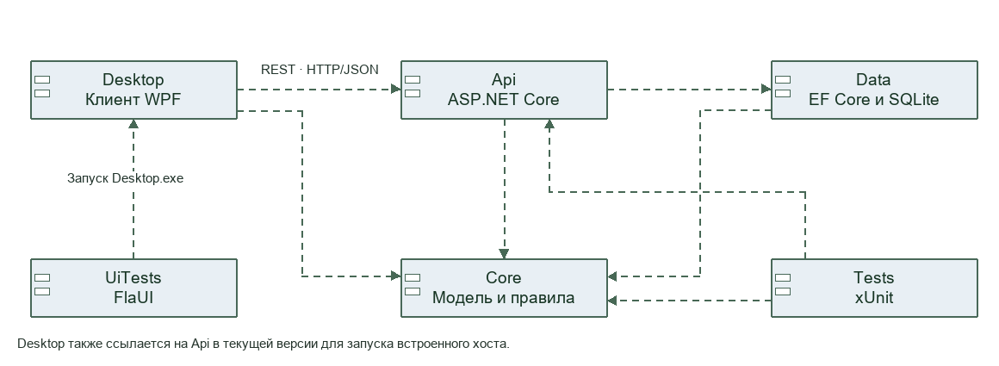
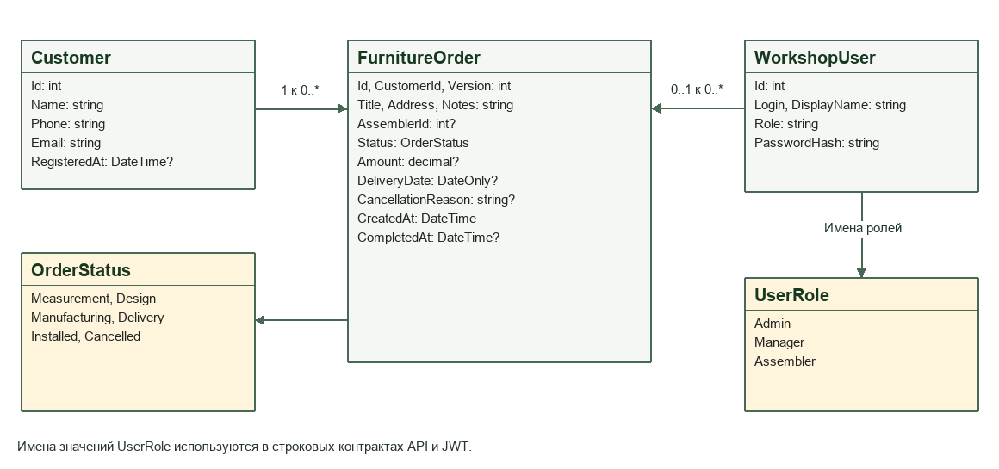

# Архитектура мебельной мастерской

УП.02, вариант 13, работа 2, занятия 4 и 5.

## Модули

| Проект | Вид | Ответственность | Зависимости проекта |
|---|---|---|---|
| FurnitureWorkshop.Core | Библиотека | Сущности, DTO, правила перехода, файлы обмена | — |
| FurnitureWorkshop.Data | Библиотека | EF Core, запросы, миграции и начальные данные | Core |
| FurnitureWorkshop.Api | ASP.NET Core | Маршруты, JWT, роли, ошибки, журнал сервера | Core, Data |
| FurnitureWorkshop.Desktop | WPF | Формы, модели представления, клиент HTTP | Core, Api для текущего запуска встроенного хоста |
| FurnitureWorkshop.Tests | xUnit | Модульные и интеграционные сценарии | Core, Api |
| FurnitureWorkshop.UiTests | xUnit и FlaUI | Запуск и проверка окон Desktop | Собранный Desktop.exe |

Core не зависит от остальных проектов. Desktop получает данные через HTTP API и не работает напрямую с SQLite. Обратные ссылки и циклы между модулями исключаются. После перехода к двум процессам Desktop будет запускаться без проектной ссылки на Api.

## Структура папок и точки входа

| Папка | Основные файлы |
|---|---|
| FurnitureWorkshop.Core | WorkshopModel.cs, OrderRules.cs, WorkshopFiles.cs |
| FurnitureWorkshop.Data | WorkshopDb.cs, WorkshopStore.cs, Migrations/ |
| FurnitureWorkshop.Api | Program.cs, WorkshopHost.cs, WorkshopEndpoints.cs, SessionTokens.cs |
| FurnitureWorkshop.Desktop | App.xaml.cs, LoginWindow.xaml, WorkspaceWindow.xaml, WorkshopClient.cs |
| FurnitureWorkshop.Tests и FurnitureWorkshop.UiTests | Сценарии xUnit, интеграционный хост и FlaUI |
| docs | Требования, схемы, спецификация API и артефакты |

## Модель данных

Один заказ ссылается на одного заказчика. Заказчик может иметь несколько заказов. Заказ может быть ещё не назначен. Один сборщик может выполнить несколько заказов. В диаграмме **OrderStatus** — действующее перечисление, **UserRole** задаёт имена ролей в контрактах API. В текущем коде роли представлены строковыми константами с теми же значениями.

## Интерфейсы модулей

| Контракт | Операции | Реализация и клиент |
|---|---|---|
| HTTP REST | Вход, заказы, заказчики, статистика и выгрузка | Api предоставляет, Desktop использует через WorkshopClient |
| Контракты Core | OrderInput, OrderInfo, CustomerInput, TransitionInput | Core определяет, Api и Desktop используют |
| Правила заказа | Next, Transition, Statistics | Core определяет, Api и Data используют |
| Хранилище заказов | FindOrders, FindOrder, CreateOrder, UpdateOrder, Transition | WorkshopStore в Data, клиент Api |
| Хранилище заказчиков | GetCustomers, CreateCustomer, UpdateCustomer, ImportCustomers | WorkshopStore в Data, клиент Api |
| Доступ к сотрудникам | GetUsers и поиск по логину | WorkshopStore и WorkshopDb в Data, клиент Api |

Для работы 8 предусмотрено выделение трёх интерфейсов хранилищ из фактических операций Data. Диаграммы можно править в Draw.io, открыв файлы `.drawio` из этой папки.
