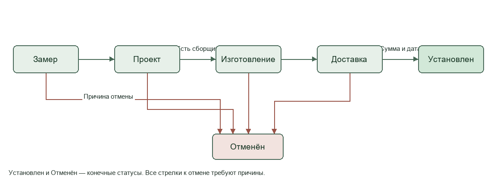

# Требования к мебельной мастерской

УП.02, вариант 13, работа 1, занятия 2 и 3.

Мастерская ведёт заказы на изготовление и установку мебели. Менеджер записывает данные заказчика, создаёт заказ и назначает сборщика. Сборщик ведёт свои заказы по этапам. Администратор контролирует журнал заказов и просматривает список учётных записей. Сам замер, изготовление мебели, перевозка и монтаж выполняются сотрудниками мастерской вне приложения.

## Роли

| Роль | Полномочия |
|---|---|
| Администратор | Общий журнал, справочник, назначение сборщика, смена статуса, общий отчёт, импорт и экспорт, список пользователей. |
| Менеджер | Общий журнал, справочник, назначение сборщика, смена статуса, общий отчёт, импорт и экспорт. |
| Сборщик | Просмотр, поиск и статистика своих заказов. Смена статуса своих заказов в пределах разрешённых переходов. |

## Как проходит заказ

Менеджер находит или регистрирует заказчика, вводит изделие и адрес, затем создаёт заказ на этапе замера. После замера заказ переходит в проектирование. Менеджер назначает сборщика. После изготовления заказ переходит в доставку, затем в установку. В рабочем статусе заказ можно отменить с указанием причины. «Установлен» и «Отменён» — конечные статусы.

| Из статуса | В статус | Условие |
|---|---|---|
| Замер | Проект | Замер завершён. Приложение разрешает последовательный переход. |
| Проект | Изготовление | Назначен пользователь с ролью сборщика. |
| Изготовление | Доставка | Приложение разрешает последовательный переход. |
| Доставка | Установлен | Указаны сумма больше нуля и дата доставки. |
| Замер, Проект, Изготовление, Доставка | Отменён | Указана причина отмены. |
| Установлен, Отменён | — | Дальнейшие переходы запрещены. |

## Функциональные требования

| Код | Требование |
|---|---|
| ФТ-01 | Пользователь входит по логину и паролю. Сервер проверяет учётные данные и выдаёт JWT. |
| ФТ-02 | Выход отзывает текущий JWT и возвращает пользователя к окну входа. |
| ФТ-03 | Администратор и менеджер создают и редактируют карточки заказчиков. Имя и телефон обязательны. Электронная почта проверяется при заполнении. |
| ФТ-04 | Новый заказ связан с существующим заказчиком, содержит изделие и адрес и получает статус «Замер». |
| ФТ-05 | Администратор и менеджер редактируют незавершённые заказы и назначают сотрудников с ролью сборщика. |
| ФТ-06 | Сервер проверяет переходы по таблице статусов, включая три условия. После установки фиксируется время завершения. |
| ФТ-07 | Сборщик видит, ищет и меняет статус только своих заказов. Прямой запрос чужого заказа возвращает 404. |
| ФТ-08 | Журнал заказа фильтруется по статусу. Поиск работает по номеру, названию изделия, адресу, имени и телефону заказчика. |
| ФТ-09 | CSV импортирует заказчиков. При ошибке в строке сервер сообщает её номер. Записи сохраняются только после успешной проверки всего файла. |
| ФТ-10 | Администратор и менеджер выгружают выбранные заказы в CSV, JSON или XML с учётом фильтров. |
| ФТ-11 | Статистика показывает число заказов по статусам, суммы и средний срок от создания до установки. Сборщик получает статистику по своим заказам. |
| ФТ-12 | Список всех учётных записей доступен администратору. Менеджер получает список сборщиков для назначения. |

## Нефункциональные требования

| Код | Требование и способ проверки |
|---|---|
| НФТ-01 | WPF-клиент собирается для Windows на .NET 10. Профиль «Мебельная мастерская» открывает окно входа. |
| НФТ-02 | Запросы WPF передаются через REST API, данные и ошибки возвращаются по согласованному JSON-контракту. Итоговый транспорт HTTPS проверяется в работе 28. |
| НФТ-03 | Пароли в SQLite хранятся как хеши PBKDF2 с отдельной солью. Текст пароля хранит только пользователь вне репозитория. |
| НФТ-04 | SQLite применяет миграции на чистой базе. Устаревшая версия заказа отклоняется с 409, чтобы сохранить изменения другого пользователя. |
| НФТ-05 | Интерфейс и пользовательские ошибки локализованы на русском. При обработке ошибок API клиенту не передаётся стек исключения. |
| НФТ-06 | Импорт ограничен 1 МиБ и 5 000 записями. Тесты проверяют отказ без частичного сохранения. |
| НФТ-07 | Покрытие строк Core должно быть не ниже 70%. Результат измеряется в работе 20. |

## Пользовательские истории

| Код | История | Критерий приёмки |
|---|---|---|
| US-01 | Как менеджер, я хочу оформить заказ покупателя, чтобы начать работу. | После выбора заказчика и заполнения изделия и адреса создаётся карточка со статусом «Замер». Без обязательного поля запись не создаётся. |
| US-02 | Как менеджер, я хочу назначить сборщика, чтобы заказ появился у исполнителя. | Без назначения нельзя начать изготовление. После назначения сборщик видит заказ в своём журнале. |
| US-03 | Как сборщик, я хочу менять этап своих заказов, чтобы коллеги могли следить за выполнением. | Допустимый переход сохраняется. Запрос на чужой заказ возвращает 404, установка без суммы или даты доставки отклоняется. |
| US-04 | Как администратор, я хочу сверить работу мастерской, чтобы подготовить отчёт. | Доступны статистика по статусам, суммы, средний срок и выгрузка выбранных заказов. |
| US-05 | Как менеджер, я хочу загрузить список заказчиков, чтобы не вводить их вручную. | Валидный CSV добавляет все строки. При ошибке показан номер строки, ни одна запись из этого файла не сохраняется. |

## Связь модулей

WPF отправляет запросы к API. API передаёт операции модулю Data, а Data обращается к SQLite через Entity Framework Core. Бизнес-правила смены статусов выполняются на серверной стороне. Для чтения чужих заказов и обхода правил клиентских проверок недостаточно, поэтому авторизация и переходы проверяются при каждом серверном запросе.
